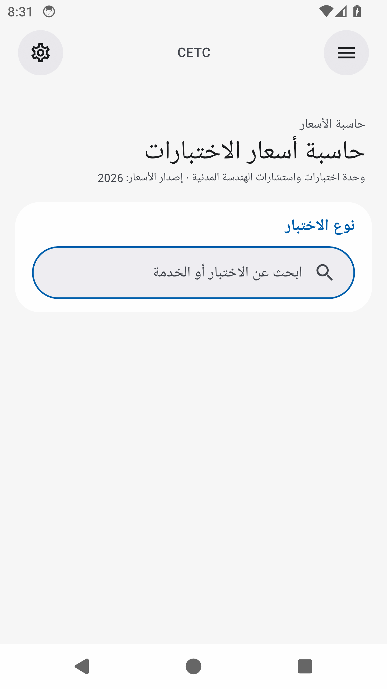
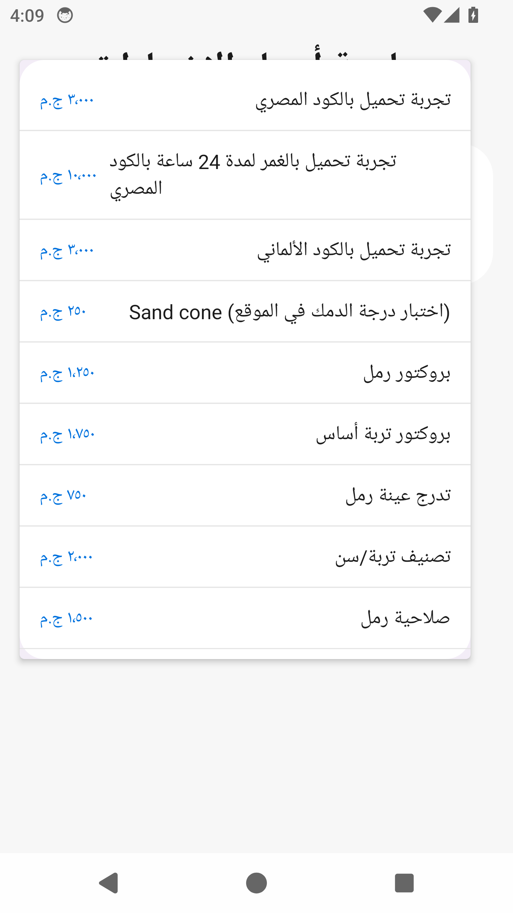
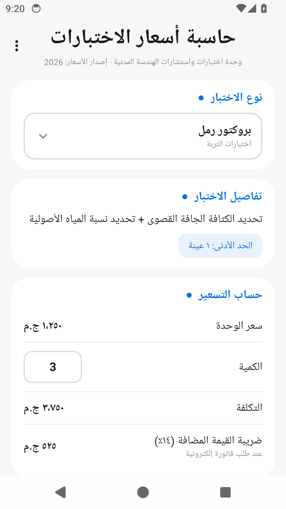
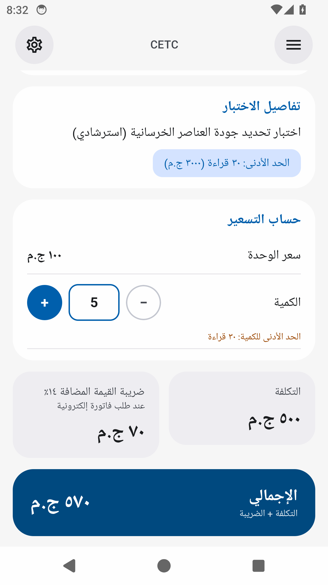
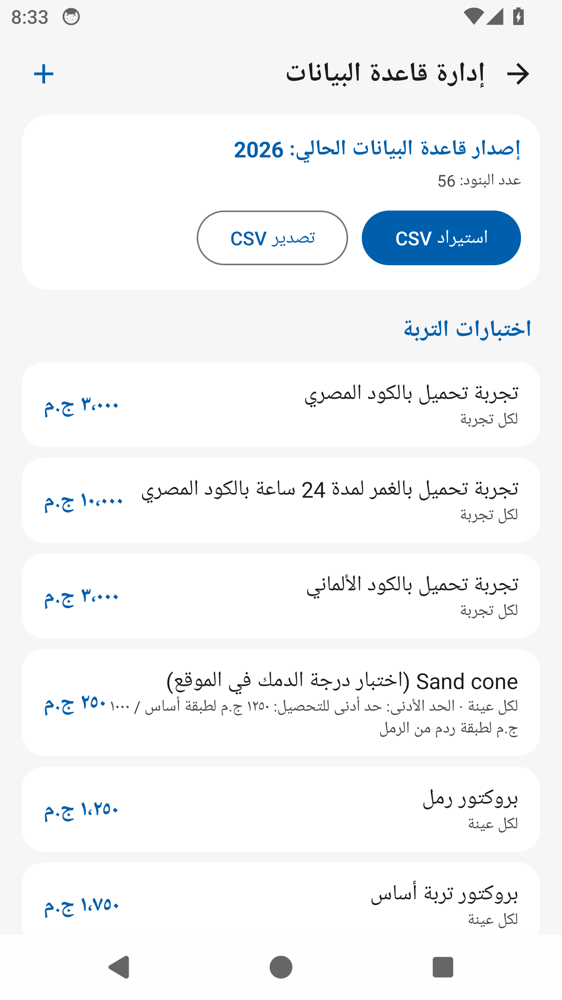
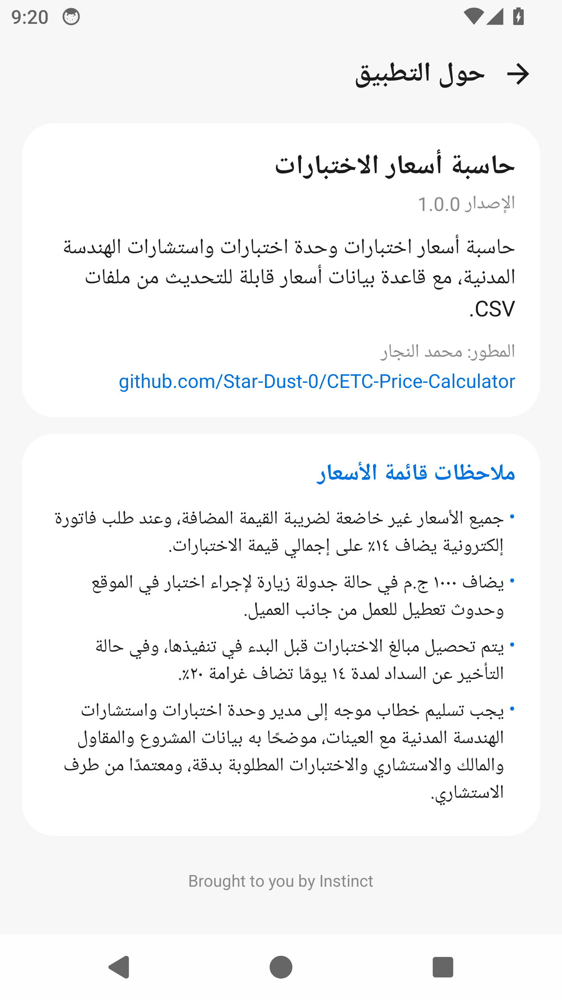

# CETC Price Calculator

A simple, polished Android calculator for the unit price list of the Civil Engineering Tests and Consultations Unit (E-JUST), built with a faithful Samsung One UI look in Arabic.

## Features

- **Test picker** — choose any of the 56 priced tests and services from a clean One UI popup menu, with per-item prices.
- **Test details** — the selected test's full description plus its minimum-quantity requirements shown in a highlighted chip.
- **Instant pricing** — unit price, quantity input, live cost, automatic 14% VAT row (always applied) and a clear grand total card.
- **Minimum-quantity guard** — a warning appears when the entered quantity is below the test's minimum.
- **Dynamic price database** — prices live in a versioned CSV file (`#version=2026`). Import a new CSV any time from inside the app, export the current database, or edit, add and delete individual items. Multi-price tests (e.g. concrete cylinder crushing: per cylinder / leveling / report) are separate selectable entries.
- **Database version label** — the active price-list version is always visible on the main screen and the database screen.

## Screenshots

Captured automatically from real emulator runs in CI (API 34, Nexus 6 profile) on every push.

| Home | Test picker | Calculation (with VAT) |
| --- | --- | --- |
|  |  |  |

| Minimum-quantity warning | Database manager | About |
| --- | --- | --- |
|  |  |  |

## Price data

The bundled database (`app/src/main/assets/prices_2026.csv`, version `2026`) mirrors the unit's published price list, update **April 2026**. All prices are in EGP and exclude VAT; a 14% VAT applies on the total when an electronic invoice is requested.

---

Developer: محمد النجار

[brought to you by Instinct](https://instinct.com)
